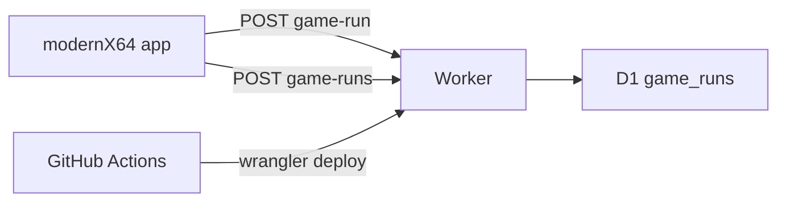

# x64 compatibility API

Host a free Cloudflare Worker and D1 database for x64 GameNative reports, deployed by GitHub Actions. The x64 app submits and reads only those two compatibility calls there; everything else stays on api.gamenative.app.

GitHub cannot accept the report POST. Supabase can, and its free tier includes the REST API, but a free project pauses after about a week without regular database traffic. This Googlebook is the only client, so the project would pause between trips and the library badges would fail until someone restores it in the dashboard. Upstream GameNative already left Supabase for a Worker for the same class of API.

Use Cloudflare Workers plus D1 instead. The free Worker plan does not pause. A library page is one indexed query, far under the 5 million row-reads per day cap. GitHub Actions deploys the Worker; GitHub is the CI, Cloudflare is the host. No custom domain: the `workers.dev` URL is enough.

## API

New repo `Bliss-Bass/gamenative-x64-compat` (Worker, `wrangler.toml`, D1 migration, one Actions workflow). Do not put this in the Android Gradle project.

Table `game_runs`: `game_name`, `arch`, `device_model`, `device_manufacturer`, `gpu_name`, `soc_name`, `android_version`, `app_version`, `configs` (JSON text), `rating` (1-5), `tags`, `notes`, `avg_fps`, `session_length_sec`, `created_at`. Index `(arch, game_name)`.

`POST /api/game-run` stores one row. Same JSON as `app/src/main/java/app/gamenative/api/GameRunApi.kt`, plus `arch`. `rating >= 4` counts as playable.

`POST /api/game-runs` accepts `gameNames`, `gpuName`, and `arch`, and returns the same per-game object `app/src/main/java/app/gamenative/utils/GameCompatibilityService.kt` already parses: `totalPlayableCount`, `gpuPlayableCount`, `avgRating`, `hasBeenTried`, `isNotWorking`. Counts are limited to that `arch`. `gpuPlayableCount` also matches `gpuName`. The x64 badge only lights when `gpuPlayableCount > 0`.

Do not require Play Integrity. This APK is not Play-distributed, so a required token would drop every report. The Worker URL is public; reject empty `gameName` or `arch`, and cap body size. That is enough at this volume.

## App

Only the `modernX64` flavor changes.

- In `app/build.gradle.kts`, add `X64_COMPAT_REPORTS=true` and `COMPAT_API_URL` set to the workers.dev URL. Leave `BLISS_PORT_DEBUG` true so PostHog and the port diagnostics stay off.
- In `app/src/main/java/app/gamenative/utils/Telemetry.kt`, `compatibilityReportsEnabled` becomes true when `X64_COMPAT_REPORTS` is set. `usageAnalyticsEnabled` stays tied to `BLISS_PORT_DEBUG`.
- `app/src/main/java/app/gamenative/api/GameRunApi.kt` adds `arch` (`x86_64`) and posts to `COMPAT_API_URL` on this flavor. Other flavors keep `https://api.gamenative.app`.
- `app/src/main/java/app/gamenative/utils/GameCompatibilityService.kt` reads from that same URL on this flavor. Update checks, community configs, and device stats stay on upstream.

The exit dialog in `app/src/main/java/app/gamenative/ui/model/MainViewModel.kt` already checks `compatibilityReportsEnabled`, so it starts showing once that flag is true. No version bump, no install, until the Worker URL exists and you ask to ship it.

## Tasks

- Add the Worker, D1 schema, and the two game-run routes in a new Bliss-Bass repo
- Deploy the Worker from GitHub Actions with a Cloudflare API token secret
- Let modernX64 submit and read reports at `COMPAT_API_URL` without turning off `BLISS_PORT_DEBUG`
